# Open Healthcare Agentic Platform

[](https://github.com/hastimal/open-healthcare-agentic-platform/actions/workflows/ci.yml)
[](LICENSE)
[](https://www.python.org/)

**Vendor-neutral, open-source, evidence-grounded healthcare search and agentic AI platform** using Python, Gemma 4, Ollama, LangGraph, MCP, Docker, Kubernetes, vLLM, and OpenTelemetry.

---

## 1. Project Purpose & Concept

Navigating clinical research, healthcare provider rosters, quality metrics, and patient guidance is often hindered by fragmented databases, proprietary lock-in, and hallucination-prone AI models.

The **Open Healthcare Agentic Platform** addresses this challenge by providing a completely open-source, vendor-neutral agentic architecture. By anchoring autonomous agents to authoritative public datasets through the **Model Context Protocol (MCP)**, the platform enables verifiable, citation-backed discovery for clinicians, researchers, and patients without relying on proprietary cloud APIs.

---

## 2. Planned Technology Stack

- **Model Intelligence**: [Gemma](https://ai.google.dev/gemma) (via local Ollama or cluster-hosted vLLM)
- **Agent Orchestration**: [LangGraph](https://langchain-ai.github.io/langgraph/) (cyclical multi-agent workflows, state management, citation validation)
- **Data Protocol**: [Model Context Protocol (MCP)](https://modelcontextprotocol.io/) (standardized healthcare data tool interfaces)
- **API & Gateway**: FastAPI (high-performance asynchronous endpoints)
- **User Interface**: Streamlit (interactive clinician and patient dashboards)
- **Packaging & Build**: Python 3.12+, Hatchling, PEP 517 src-layout
- **Deployment & Orchestration**: Docker, Docker Compose, Kubernetes, Helm
- **Observability**: OpenTelemetry, Prometheus, Grafana, Tempo

---

## 3. Four Public Healthcare Data Sources

The platform will integrate four authoritative, publicly available healthcare repositories:

1. **NPPES (National Plan and Provider Enumeration System)**: Registry for healthcare providers, National Provider Identifiers (NPIs), practice locations, and medical taxonomy specialties.
2. **PubMed (NCBI Entrez)**: Biomedical research literature, peer-reviewed clinical studies, and abstract citations.
3. **CMS Provider Data**: Centers for Medicare & Medicaid Services clinician performance metrics, facility quality ratings, and hospital data.
4. **MedlinePlus**: National Library of Medicine consumer health information covering conditions, wellness, and prescription drugs.

---

## 4. Six-Phase Milestone Roadmap

- [x] **Milestone M1 — Repository Foundation, Python & CI**:
  - PEP 517 packaging with `src/` layout, Hatchling backend.
  - Safe configuration loader and environment variable scaffolding.
  - `healthcare-agents` CLI with `--version` and `health`/`status` commands.
  - Automated testing (pytest, coverage), Ruff linting/formatting, mypy strict typing.
  - GitHub Actions CI workflow for Python 3.12.
- [x] **Milestone M2 — Gemma 4 + Ollama Local Serving**:
  - Local model runtime integration via Ollama (`gemma4:e2b`).
  - Unified model adapter abstraction (`src/healthcare_agents/models/`) and streaming prompt interface.
  - CLI model subcommands: `healthcare-agents model status` and `healthcare-agents model chat`.
  - Offline unit tests and opt-in live local inference tests with 93%+ coverage.
- [x] **Milestone M3 — LangGraph Multi-Agent Orchestration**:
  - Typed multi-agent discovery workflow using LangGraph (`src/healthcare_agents/workflows/`).
  - Five core agent modules: Planner, Provider Retrieval, Research Evidence, Deterministic Validator, and Answer Synthesis.
  - Deterministic Python verification for deduplication, NPI validity, and claim grounding.
  - Comprehensive offline test suite and opt-in real Gemma 4 LangGraph tests.
- [x] **Milestone M4A — Live NPPES Provider Discovery**:
  - Real public CMS NPPES NPI Registry API version 2.1 client (`src/healthcare_agents/retrieval/nppes_client.py`).
  - Real provider search by specialty, taxonomy description, city, state, and direct 10-digit NPI lookup.
  - Practice location validation against LOCATION addresses and relevant provider taxonomy filtering.
- [x] **Milestone M4B — Live PubMed Biomedical Research Literature Discovery**:
  - Official NCBI Entrez E-utilities client (`src/healthcare_agents/retrieval/pubmed_client.py`) implementing ESearch and EFetch.
  - Live biomedical literature retrieval by query topic, full abstracts, authors, journals, DOIs, and PubMed URLs.
  - Rate-limiting (3 req/s without key, 10 req/s with key) and exponential backoff retry.
  - Deterministic validation of PMID format, PubMed URLs, duplicate detection, and research independence guardrails.
  - Grounded Gemma 4 synthesis citing real NPPES providers and real PubMed literature.
- [x] **Milestone M4C — CMS Provider Data Quality Metrics & Affiliations**:
  - Official CMS Provider Data Catalog client (`src/healthcare_agents/retrieval/cms_client.py`).
  - Clinician MIPS quality measures (`a174-a962`), hospital general information and star ratings (`xubh-q36u`), and facility affiliations (`27ea-46a8`).
  - Safe, exact NPI-based joins against candidate providers; unmatched CMS records kept strictly unjoined.
  - PubMed query refinement (`[Title/Abstract]` and `[MeSH Terms]`) and deterministic title/abstract relevance safeguards preventing unrelated study retrieval.
  - Quality guardrails: missing CMS quality data explicitly documented as lack of public program scope (e.g. dentistry), never low quality.
- [x] **Milestone M4D — Live MedlinePlus Patient Education Integration**:
  - Official U.S. National Library of Medicine (NLM) MedlinePlus Web Service client (`src/healthcare_agents/retrieval/medlineplus_client.py`).
  - Authoritative English (`healthTopics`) and Spanish (`healthTopicsSpanish`) consumer health topics, official URLs, and plain-language summaries.
  - Client-side throttling enforcing strict acceptable use threshold (<85 req/min) and thread-safe in-memory 12h TTL caching.
  - Optional MedlinePlus Connect adapter for standardized ICD-10-CM / RxCUI / SNOMED CT code-based education.
  - Comprehensive deterministic validation: official MedlinePlus domain verification, consumer education guardrails, and 4-way data source separation.
- [x] **Milestone M4E — Unified Evidence Normalization, Ranking, Deduplication & Provenance**:
  - Unified evidence processing layer (`src/healthcare_agents/evidence/`) across all four live public healthcare sources.
  - Typed normalization preserving underlying source records (`original_provider`, `original_record`, `original_cms`).
  - Deterministic deduplication (exact 10-digit NPI, exact PMID/DOI, CMS reporting period isolation, canonical MedlinePlus URLs with English/Spanish distinction).
  - Explainable source-specific relevance and ranking (no fabricated universal clinician quality score).
  - Explicit topical regression guards (rejection of unrelated studies such as PMID 39046104 dementia GWAS for pediatric dental queries).
  - Traceable source provenance ledger verifying authorized domains (`nih.gov`, `cms.gov`, `hhs.gov`) and citation boundaries.
- [x] **Milestone M5 — FastAPI + Streamlit Web Application**:
  - High-performance FastAPI REST backend (`healthcare_agents.api`) supporting `/health`, `/ready`, `/api/v1/status`, and `/api/v1/search`.
  - Reusable execution service orchestrating LangGraph multi-agent discovery.
  - Interactive, professional Streamlit web application (`healthcare_agents.ui`) with quick clinical presets, real-time readiness status, and 4 tabbed result views.
  - Expandable provenance audit ledger with official verification badges and cryptographic digest verification.
  - Streamlit automated browser testing and real screenshot capture via Playwright.
  - CLI commands: `healthcare-agents serve` and `healthcare-agents ui`.
- [x] **Milestone M6 — Docker Compose Containerization** *(Current)*:
  - Production-ready multi-stage Dockerfiles (`Dockerfile.api` and `Dockerfile.ui`) with non-root security (`appuser:10001`) and minimal ~198MB image sizes.
  - Multi-profile Docker Compose configuration (`docker-compose.yml`):
    - **Profile A (Recommended Apple Silicon Profile)**: Runs API and UI in Docker containers, connecting to native host Ollama (`host.docker.internal:11434`) for full Metal GPU hardware acceleration.
    - **Profile B (Containerized Ollama Profile)**: Runs complete containerized stack (`--profile container-ollama`) with persistent model volume (`open-healthcare-ollama-models`) and model bootstrap script (`scripts/bootstrap_model.sh`).
  - Internal Docker DNS networking (`healthcare-net`), container health checks, and restart recovery.
  - Browser verification via Playwright capturing real container screenshots (`docs/images/m6_container_ui.png`, `docs/images/m6_container_results.png`).
- [x] **Milestone M6.1 — UI Experience & Agent Execution Visibility**:
  - High-contrast, dual-theme application header with verified branding palette (`#EF4444`, `#38BDF8`, `#F8FAFC`, `#CBD5E1`).
  - Structured MedlinePlus consumer health education formatting (`html_to_clean_markdown`) preserving clinical sections, questions, headings, paragraphs, and bullet lists.
  - Runtime multi-agent execution telemetry (`ExecutionEvent` schema) tracking monotonic durations, start/end timestamps, result counts, and inspectable outgoing queries dispatched to NPPES, PubMed, CMS, and MedlinePlus.
  - Interactive Streamlit `"🧠 Agent Execution & Observability"` timeline with execution metrics breakdown and inspectable stage expanders.
- [x] **Milestone M7 — Intelligent Query Fan-Out, Parallel Retrieval & Workflow Graph**:
  - Fixed M6.1 count semantics and dynamic live/fixture mode labeling in agent answer synthesis and UI banners.
  - Intelligent query fan-out planning (`PlannedQuery` and `FanOutPlan`) converting patient questions into targeted multi-source queries across NPPES, PubMed, MedlinePlus, and CMS with deterministic fallback.
  - Concurrent multi-source retrieval engine using bounded worker pools (`ThreadPoolExecutor(max_workers=4)`) with strict dependent ordering for CMS quality lookups.
  - Evidence relevance optimization and dental guardrails excluding peripheral/unrelated medical conditions (e.g. eating disorders, dementia) on oral health inquiries.
  - Interactive Streamlit `"⚡ Agent Workflow & Query Fan-Out"` tab featuring an executed Mermaid pipeline diagram, planned vs. dispatched queries table, and concurrency breakdown.
  - Controlled benchmarking measuring a **42.75% retrieval latency reduction** (target $\ge 25\%$).
  - OpenTelemetry readiness: `query_id` and `dependency_ids` correlated on execution events.
- [x] **Milestone M8 — OpenTelemetry, Prometheus, Tempo & Grafana Observability** *(Current Feature Branch)*:
  - Centralized `healthcare_agents.observability` subsystem with standard OpenTelemetry SDK, TracerProvider, MeterProvider, and OTLP Protobuf over HTTP exporters.
  - Full W3C distributed trace propagation across Streamlit UI, FastAPI service, LangGraph agent execution stages, concurrent parallel retrievers, and native host Ollama / Gemma 4 inference.
  - High-resolution application metrics tracking search requests, stage latencies, source-specific retrieval failures/timeouts/fallbacks, evidence quality counts (retrieved, retained, deduplicated, excluded), and real token metrics.
  - Provisioned Docker Compose observability stack featuring OpenTelemetry Collector, Prometheus, Grafana Tempo, and Grafana with automated provisioning.
  - Pre-built 6-section Grafana monitoring dashboard: **"Open Healthcare Agentic AI — Observability"** (`uid: healthcare-observability`).
  - Interactive Streamlit distributed trace correlation with deep-linking directly into Grafana Tempo trace exploration.
  - One-command demonstration launcher (`python scripts/run_m8_demo.py`) with complete container and host service health verification.

---

## 5. Workflow Architecture & Observability

### Milestone M8 — Production-Grade Observability (Current)

Milestone M8 delivers end-to-end distributed tracing, application metrics, and real-time observability across the multi-agent discovery pipeline:

#### 1. Platform Overview & Latency Telemetry

*Figure: Grafana Section 1 showing real-time platform request volume, P50/P95/P99 latency measurements, and HTTP status distributions.*

#### 2. LangGraph Agent Workflow Execution

*Figure: Grafana Section 2 breaking down execution latency across Planner, Query Fan-Out, Parallel Retrieval, Evidence Processing, and Answer Synthesis.*

#### 3. Parallel Multi-Source Retrieval Metrics
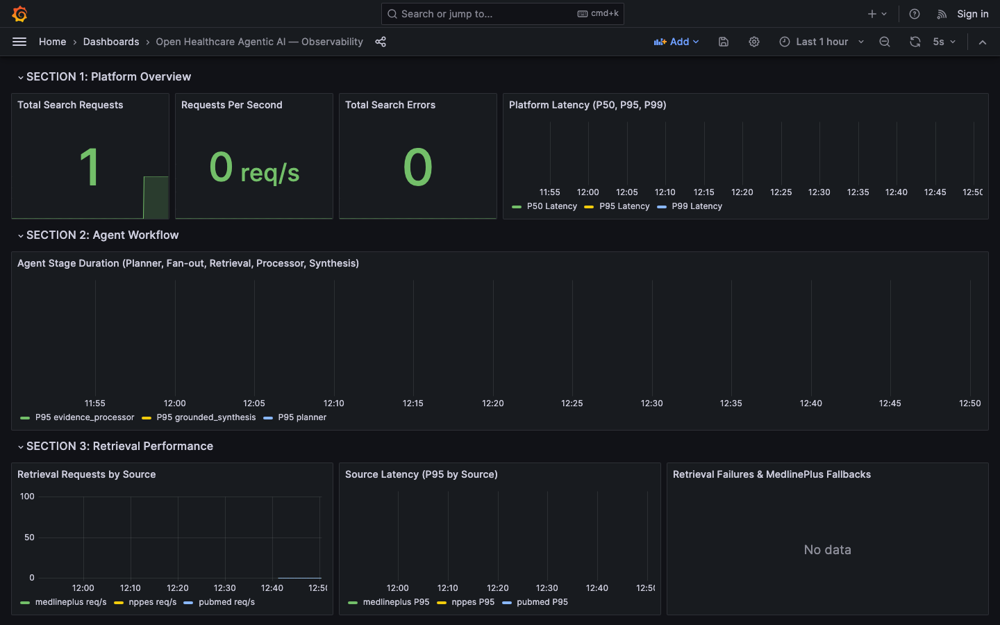
*Figure: Grafana Section 3 monitoring request volume, latencies, failure rates, and zero-hit MedlinePlus consumer fallback activations across NPPES, PubMed, MedlinePlus, and CMS.*

#### 4. Evidence Processing & Filtering Quality

*Figure: Grafana Section 4 tracking evidence counts through retrieved, retained, excluded, and deduplicated pipeline stages.*

#### 5. Local Gemma 4 / Ollama Inference Metrics

*Figure: Grafana Section 5 reporting real model inference latencies and actual prompt/completion token counts directly from native Ollama responses.*

#### 6. Grafana Tempo Distributed Trace Tree
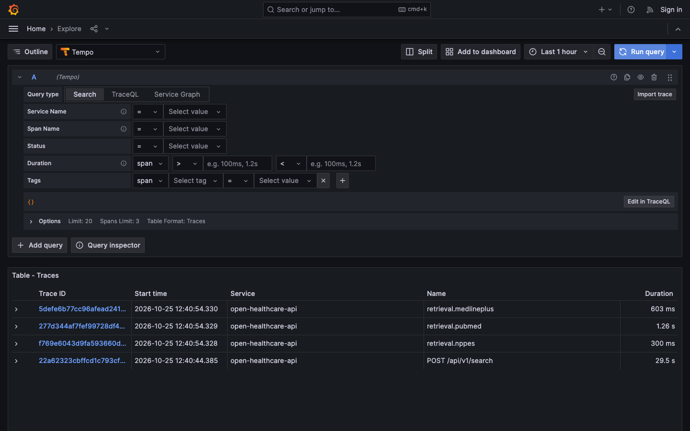
*Figure: Full distributed trace showing the root search span, concurrent retriever child spans, and LLM inference under W3C TraceContext propagation.*

#### 7. Streamlit Trace Correlation & Deep Link
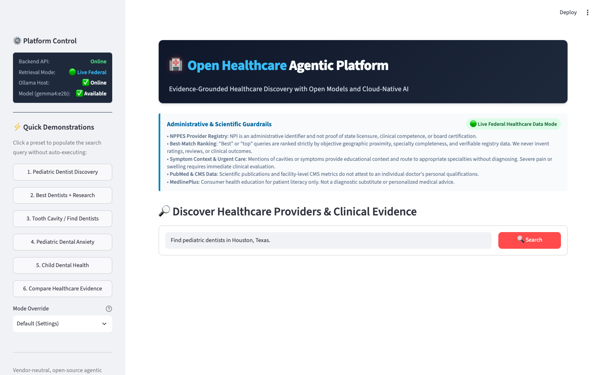
*Figure: Streamlit interface presenting verifiable Hex Trace IDs and deep links directly into the Grafana Tempo trace view.*

---

### Milestone M7 — Intelligent Query Fan-Out & Parallel Workflow

Milestone M7 introduces structured multi-source query fan-out, concurrent parallel retrieval, and an interactive agent workflow visualization graph:

#### 1. Agent Workflow & Query Fan-Out Interface
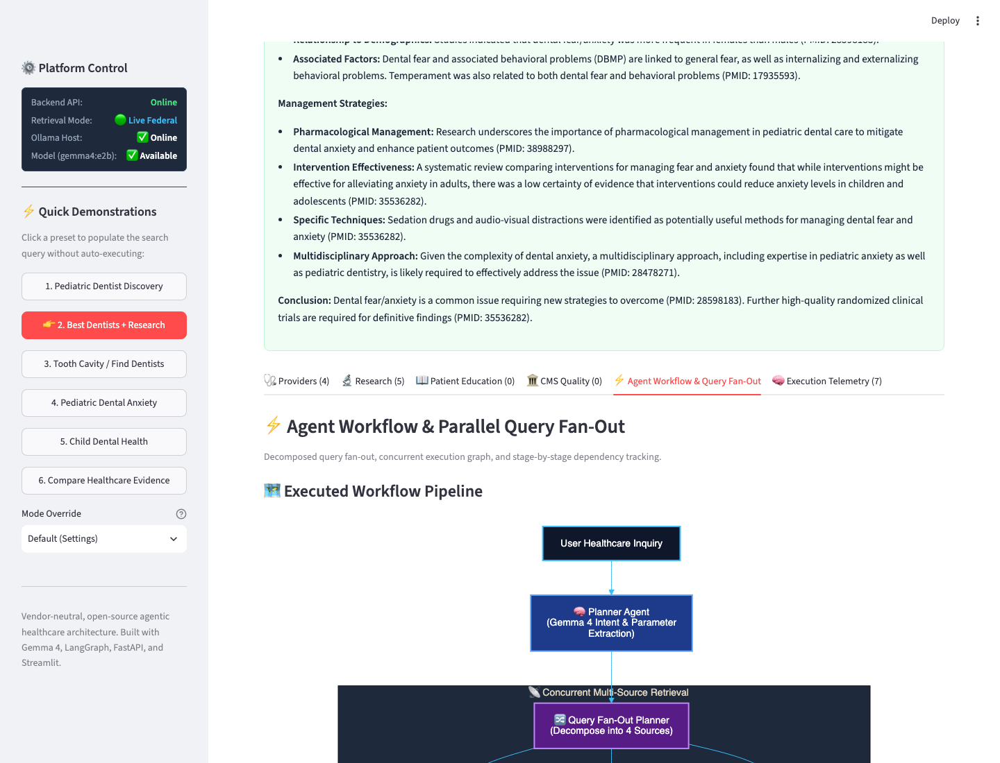
*Figure: Real-time executed pipeline graph, planned vs. dispatched queries table with source parameters, and concurrency breakdown.*

#### 2. Grounded Healthcare Discovery Results
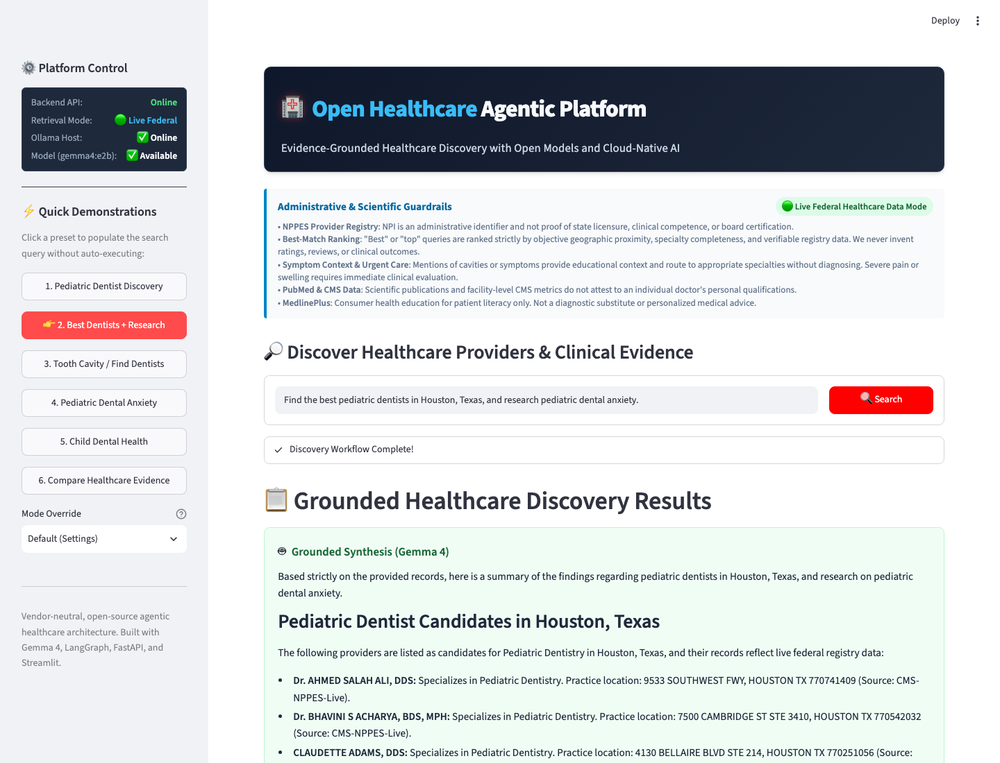
*Figure: Grounded healthcare discovery synthesis generated by Gemma 4 with validated federal citations across NPPES, PubMed, and MedlinePlus.*

#### 3. Structured Consumer Health Education
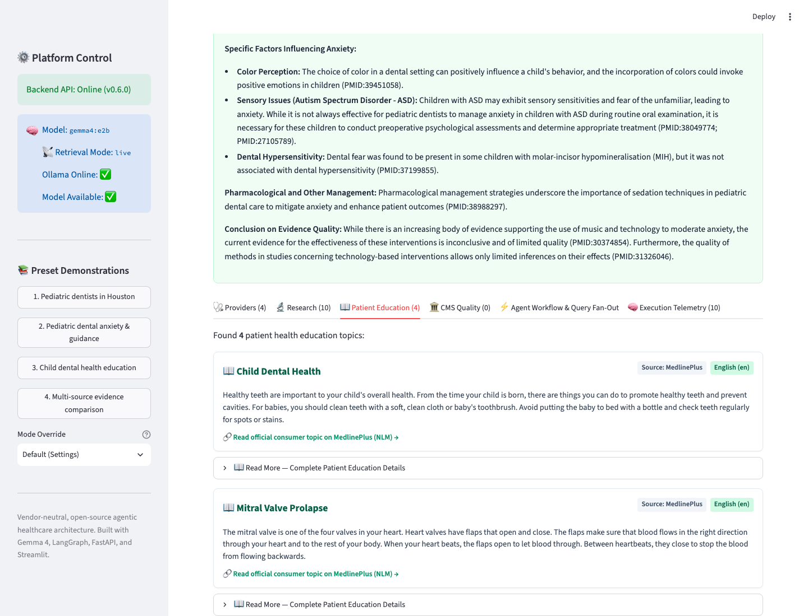
*Figure: Filtered MedlinePlus health topics retaining directly relevant concepts (e.g., Child Dental Health) and excluding peripheral conditions.*

#### 4. Real-Time Multi-Agent Execution Telemetry
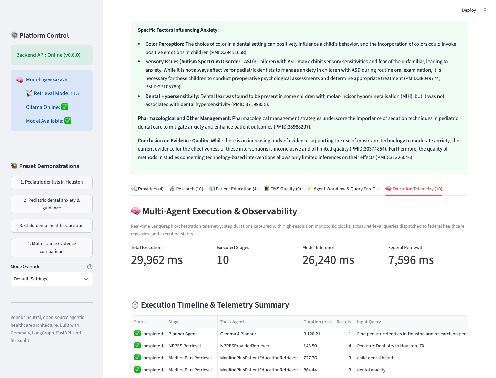
*Figure: Multi-agent execution telemetry capturing stage durations, monotonic timing, and inspectable tool queries.*

### Milestone M6.1 — UI Experience & Multi-Agent Observability Interface

Milestone M6.1 brings high-contrast dual-theme branding, structured MedlinePlus patient health education formatting, and real-time LangGraph multi-agent execution telemetry:

#### 1. High-Contrast Header Branding
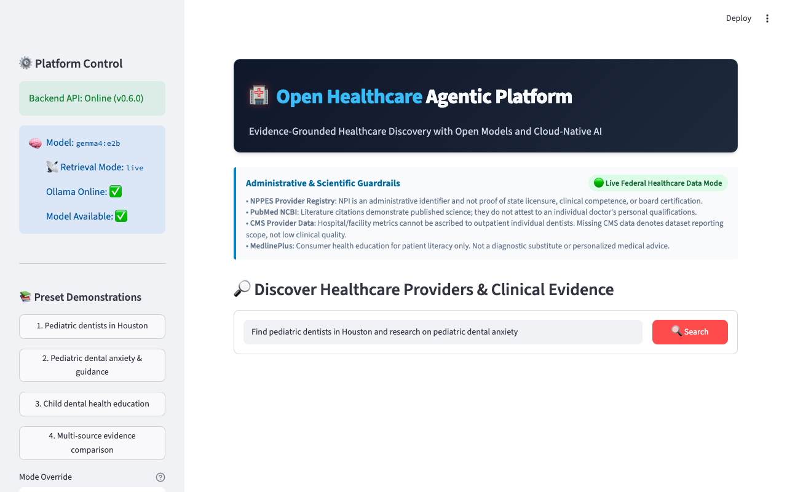
*Figure: High-contrast header featuring verified branding colors (`#EF4444`, `#38BDF8`, `#F8FAFC`, `#CBD5E1`) in a deep slate container, optimized for dark and light Streamlit themes.*

#### 2. Structured Patient Education Formatting
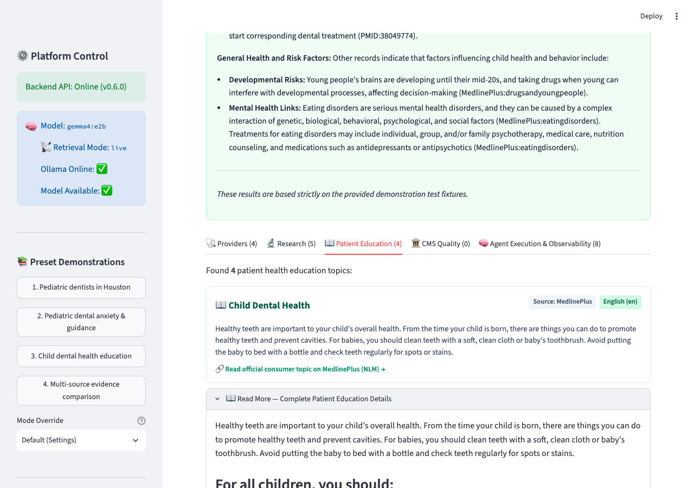
*Figure: Formatted MedlinePlus consumer health education cards preserving inquiry headings, section labels, paragraphs, and bullet lists, with expandable "Read More" full-content view.*

#### 3. Real-Time Multi-Agent Execution Observability & Timeline
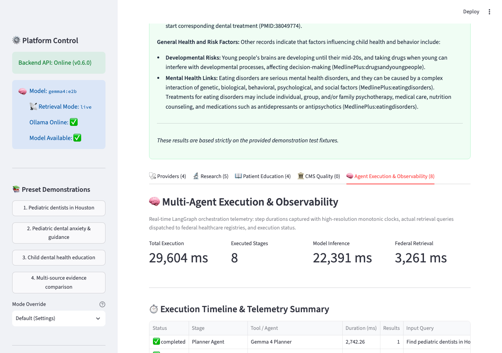
*Figure: Live LangGraph execution telemetry captured via monotonic clocks (`ExecutionEvent` schema), displaying stage durations, status badges, and inspectable queries dispatched to NPPES, PubMed, CMS, and MedlinePlus.*

### Milestone M6 — Docker Compose Container Architecture

The containerized platform architecture encapsulates the FastAPI service gateway, the Streamlit UI, and the multi-agent LangGraph core with dual-profile model execution:

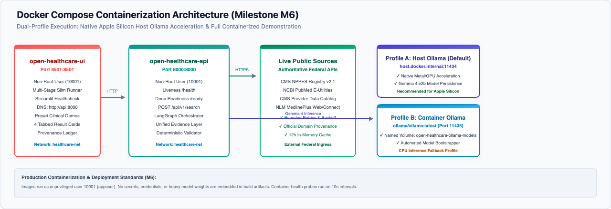

### Containerized Streamlit Web Interface

The Streamlit web application running inside Docker provides a responsive, evidence-backed discovery interface for clinicians, researchers, and patients:

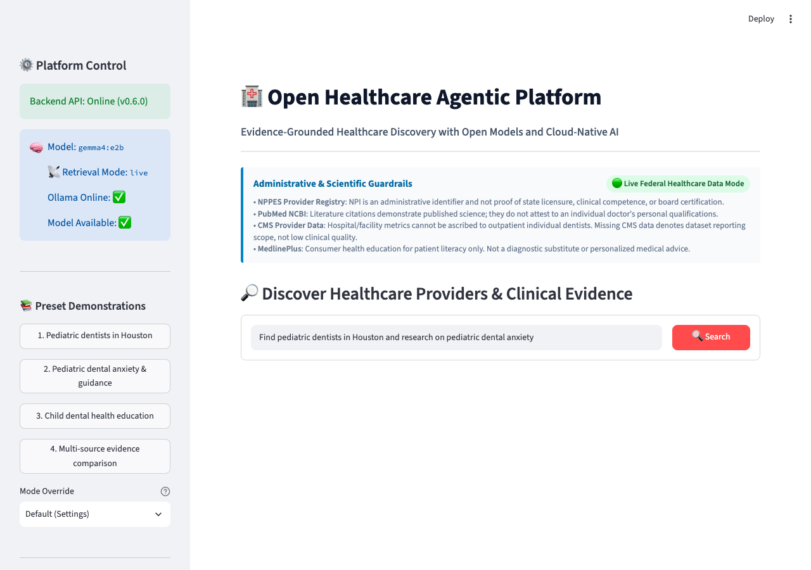

*Figure: Initial Streamlit interface running in Docker (`http://localhost:8501`), demonstrating preset clinical discovery scenarios, system readiness badges, and safety disclaimers.*

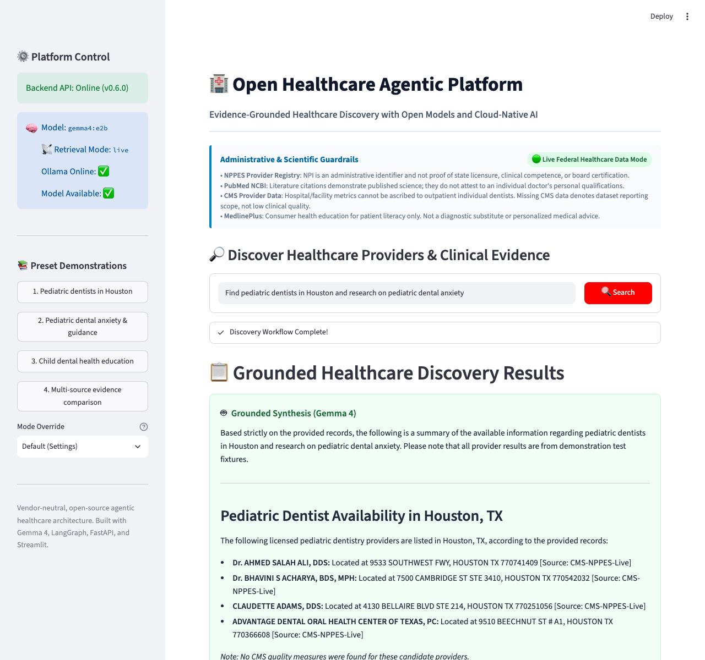

*Figure: Containerized multi-agent discovery results with grounded narrative synthesis, validated NPPES provider credentials, PubMed research citations, MedlinePlus patient guidance, and the cryptographic provenance audit ledger.*

### Milestone M5 — Presentation Layer & Full System Architecture

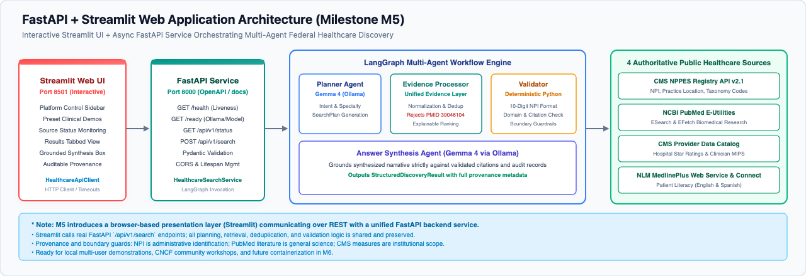

### Milestone M4E — Unified Evidence Processing & Multi-Source Discovery

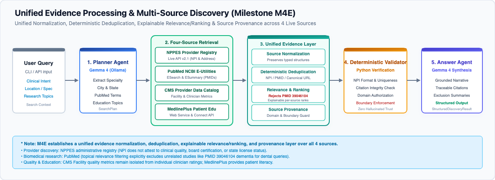

> **Administrative & Clinical Disclaimer**: Provider records are retrieved live from the public CMS National Plan and Provider Enumeration System (NPPES) Registry API version 2.1. An NPI is an administrative standard identifier under HIPAA and is **NOT** proof of professional medical licensure, clinical competence, board certification, or service quality. Biomedical research citations retrieved from NCBI PubMed establish that a publication exists in the scientific literature, not that its conclusions are universally valid or applicable to an individual patient. CMS Provider Data quality metrics (MIPS scores and hospital star ratings) reflect public program participation; the absence of CMS measures for a provider (common in non-Medicare specialties like pediatric dentistry) denotes dataset reporting scope, not poor clinical quality. MedlinePlus patient education content provides general consumer health literacy and does not constitute personalized clinical advice, diagnosis, or treatment. Always consult a licensed clinician.

### Milestone M4C — Live NPPES, PubMed & CMS Quality Workflow

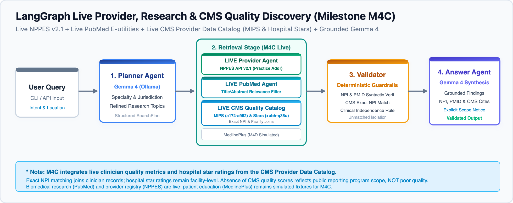

### Milestone M3 — Multi-Agent LangGraph Core Architecture (Synthetic Fixtures)

The foundational multi-agent orchestration architecture coordinates planning, deterministic fixture retrieval, deterministic validation, and grounded Gemma 4 synthesis:

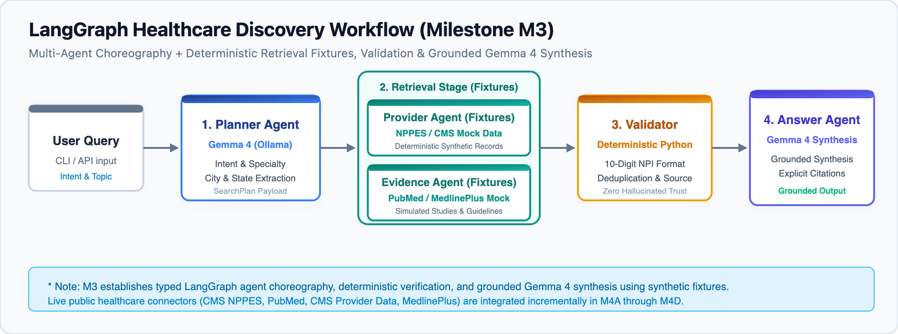

---

## 6. Local Developer Setup & Installation

### Requirements
- Python 3.12 or newer
- Git
- Ollama with `gemma4:e2b` installed

### Installation
Clone the repository and set up a virtual environment:

```bash
git clone https://github.com/hastimal/open-healthcare-agentic-platform.git
cd open-healthcare-agentic-platform

python3.12 -m venv .venv
source .venv/bin/activate

pip install --upgrade pip
pip install -e ".[dev]"
```

Initialize your local configuration:
```bash
cp .env.example .env
```

---

## 7. CLI Usage & Agent Discovery

Verify the installed CLI tool and run multi-agent discovery:

```bash
# Check version
healthcare-agents --version

# Check configuration health status
healthcare-agents health

# Check local model connection (Ollama + Gemma 4)
healthcare-agents model status

# Execute LangGraph multi-agent discovery workflow via CLI
healthcare-agents search --query "Find pediatric dentists in Houston"

# Detailed stage-by-stage multi-agent progression
healthcare-agents search --query "Find pediatric dentists in Houston" --verbose

# Launch FastAPI REST Service (Port 8000)
healthcare-agents serve --host 127.0.0.1 --port 8000

# Launch Streamlit Web Application (Port 8501)
healthcare-agents ui --port 8501
```

---

## 8. Docker Compose Deployment (Milestone M6)

The platform supports dual Docker Compose execution profiles:

### Profile A: Recommended Apple Silicon Development Profile
Runs the FastAPI service and Streamlit UI in lightweight Docker containers while connecting to your native host Ollama instance via `host.docker.internal:11434` for full Apple Silicon Metal GPU acceleration:

```bash
# Build and launch API (port 8000) and UI (port 8501)
docker compose up -d --build

# Inspect container health and readiness
docker compose ps
curl -s http://localhost:8000/ready
curl -s http://localhost:8501/_stcore/health

# Open Streamlit in your browser
open http://localhost:8501
```

### Profile B: Fully Containerized Demonstration Profile
Runs the entire stack in Docker containers, including the official Ollama container and model bootstrapper:

```bash
# Start all services with containerized Ollama and persistent model volume
docker compose --profile container-ollama up -d --build
```

---

## 9. Running Automated Tests & Code Quality

Run tests offline with code coverage:
```bash
pytest
```

Run with opt-in live Ollama + Gemma 4 workflow tests:
```bash
HEALTHCARE_AGENTS_LIVE_TESTS=1 pytest
```

Run linting and formatting verification:
```bash
ruff check .
ruff format --check .
```

Run static type checking:
```bash
mypy src tests
```

Build a distributable wheel and source archive:
```bash
python -m build
```

---

## 10. Current Implemented Functionality vs. Future Status

- **Currently Implemented (M1–M6)**:
  - Packaging, configuration, environment validation, CLI commands (`health`, `model`, `search`, `serve`, `ui`).
  - Local Gemma 4 serving via Ollama adapter (`src/healthcare_agents/models/`).
  - LangGraph multi-agent orchestration workflow (`src/healthcare_agents/workflows/`).
  - Four live public healthcare retrieval clients (NPPES, PubMed, CMS, MedlinePlus).
  - Unified evidence normalization, deterministic deduplication, relevance scoring, and provenance tracking (`src/healthcare_agents/evidence/`).
  - FastAPI service gateway with OpenAPI documentation and health probes (`src/healthcare_agents/api/`).
  - Streamlit web application with presets, status tracking, and tabbed evidence cards (`src/healthcare_agents/ui/`).
  - Multi-profile Docker Compose containerization (`docker-compose.yml`, `Dockerfile.api`, `Dockerfile.ui`, `scripts/bootstrap_model.sh`).
  - Comprehensive offline unit/integration test suite (90%+ coverage) and Playwright browser validation.
- **Future Milestones (M7)**:
  - Kubernetes manifests, Helm charts, distributed tracing, and cluster-scale vLLM GPU serving.

For detailed architecture details, refer to [docs/architecture/README.md](docs/architecture/README.md).

---

## 10. Non-Clinical / Research Disclaimer

> **IMPORTANT DISCLAIMER**: This software is designed exclusively for research, education, and informational discovery. It is **NOT** a medical device, diagnostic tool, or clinical decision support system. It is not intended to diagnose, cure, mitigate, treat, or prevent any medical condition. Always consult a qualified healthcare professional regarding any medical diagnosis or treatment options.

---

## 10. License

This project is licensed under the [Apache License 2.0](LICENSE).
