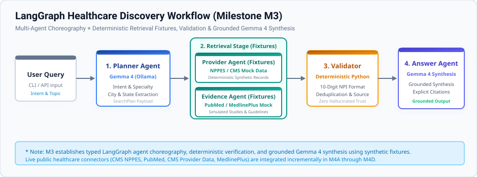

# Open Healthcare Agentic Platform

[](https://github.com/hastimal/open-healthcare-agentic-platform/actions/workflows/ci.yml)
[](LICENSE)
[](https://www.python.org/)

**Vendor-neutral, open-source, evidence-grounded healthcare search and agentic AI platform** using Python, Gemma 4, Ollama, LangGraph, MCP, Docker, Kubernetes, vLLM, and OpenTelemetry.

---

## 1. Project Purpose & Concept

Navigating clinical research, healthcare provider rosters, quality metrics, and patient guidance is often hindered by fragmented databases, proprietary lock-in, and hallucination-prone AI models.

The **Open Healthcare Agentic Platform** addresses this challenge by providing a completely open-source, vendor-neutral agentic architecture. By anchoring autonomous agents to authoritative public datasets through the **Model Context Protocol (MCP)**, the platform enables verifiable, citation-backed discovery for clinicians, researchers, and patients without relying on proprietary cloud APIs.

---

## 2. Planned Technology Stack

- **Model Intelligence**: [Gemma](https://ai.google.dev/gemma) (via local Ollama or cluster-hosted vLLM)
- **Agent Orchestration**: [LangGraph](https://langchain-ai.github.io/langgraph/) (cyclical multi-agent workflows, state management, citation validation)
- **Data Protocol**: [Model Context Protocol (MCP)](https://modelcontextprotocol.io/) (standardized healthcare data tool interfaces)
- **API & Gateway**: FastAPI (high-performance asynchronous endpoints)
- **User Interface**: Streamlit (interactive clinician and patient dashboards)
- **Packaging & Build**: Python 3.12+, Hatchling, PEP 517 src-layout
- **Deployment & Orchestration**: Docker, Docker Compose, Kubernetes, Helm
- **Observability**: OpenTelemetry, Prometheus, Grafana, Tempo

---

## 3. Four Public Healthcare Data Sources

The platform will integrate four authoritative, publicly available healthcare repositories:

1. **NPPES (National Plan and Provider Enumeration System)**: Registry for healthcare providers, National Provider Identifiers (NPIs), practice locations, and medical taxonomy specialties.
2. **PubMed (NCBI Entrez)**: Biomedical research literature, peer-reviewed clinical studies, and abstract citations.
3. **CMS Provider Data**: Centers for Medicare & Medicaid Services clinician performance metrics, facility quality ratings, and hospital data.
4. **MedlinePlus**: National Library of Medicine consumer health information covering conditions, wellness, and prescription drugs.

---

## 4. Six-Phase Milestone Roadmap

- [x] **Milestone M1 — Repository Foundation, Python & CI**:
  - PEP 517 packaging with `src/` layout, Hatchling backend.
  - Safe configuration loader and environment variable scaffolding.
  - `healthcare-agents` CLI with `--version` and `health`/`status` commands.
  - Automated testing (pytest, coverage), Ruff linting/formatting, mypy strict typing.
  - GitHub Actions CI workflow for Python 3.12.
- [x] **Milestone M2 — Gemma 4 + Ollama Local Serving**:
  - Local model runtime integration via Ollama (`gemma4:e2b`).
  - Unified model adapter abstraction (`src/healthcare_agents/models/`) and streaming prompt interface.
  - CLI model subcommands: `healthcare-agents model status` and `healthcare-agents model chat`.
  - Offline unit tests and opt-in live local inference tests with 93%+ coverage.
- [x] **Milestone M3 — LangGraph Multi-Agent Orchestration** *(Current)*:
  - Typed multi-agent discovery workflow using LangGraph (`src/healthcare_agents/workflows/`).
  - Five core agent modules: Planner, Provider Retrieval, Research Evidence, Deterministic Validator, and Answer Synthesis.
  - Deterministic Python verification for deduplication, NPI validity, and claim grounding.
  - Deterministic synthetic fixtures for provider & evidence retrieval (preparing interfaces for M4 live connectors).
  - CLI discovery command: `healthcare-agents search --query "..." [--verbose]`.
  - Comprehensive offline test suite (96.14% coverage) and opt-in real Gemma 4 LangGraph tests.
- [ ] **Milestone M4 — Model Context Protocol (MCP) Healthcare Data Tools**:
  - Connectors and MCP servers for NPPES, PubMed, CMS Provider Data, and MedlinePlus.
- [ ] **Milestone M5 — Streamlit UI & FastAPI Gateway**:
  - Interactive web interface for clinicians and patients, REST and streaming APIs.
- [ ] **Milestone M6 — Docker, Kubernetes, vLLM & OpenTelemetry**:
  - Production containerization, Helm charts, distributed tracing, and GPU serving.

---

## 5. Workflow Architecture (Milestone M3)

The LangGraph orchestration flow executes bounded, typed state transitions across specialized agents:



> **Note on Retrieval Data**: In Milestone M3, provider and research evidence retrieval uses deterministic synthetic fixtures to validate multi-agent coordination without external network dependencies. Live public healthcare API integrations (NPPES, PubMed, CMS, MedlinePlus) are implemented in Milestone M4.

---

## 6. Local Developer Setup & Installation

### Requirements
- Python 3.12 or newer
- Git
- Ollama with `gemma4:e2b` installed

### Installation
Clone the repository and set up a virtual environment:

```bash
git clone https://github.com/hastimal/open-healthcare-agentic-platform.git
cd open-healthcare-agentic-platform

python3.12 -m venv .venv
source .venv/bin/activate

pip install --upgrade pip
pip install -e ".[dev]"
```

Initialize your local configuration:
```bash
cp .env.example .env
```

---

## 7. CLI Usage & Agent Discovery

Verify the installed CLI tool and run multi-agent discovery:

```bash
# Check version
healthcare-agents --version

# Check configuration health status
healthcare-agents health

# Check local model connection (Ollama + Gemma 4)
healthcare-agents model status

# Execute LangGraph multi-agent discovery workflow
healthcare-agents search --query "Find pediatric dentists in Houston"

# Detailed stage-by-stage multi-agent progression
healthcare-agents search --query "Find pediatric dentists in Houston" --verbose
```

---

## 8. Running Automated Tests & Code Quality

Run tests offline with code coverage:
```bash
pytest
```

Run with opt-in live Ollama + Gemma 4 workflow tests:
```bash
HEALTHCARE_AGENTS_LIVE_TESTS=1 pytest
```

Run linting and formatting verification:
```bash
ruff check .
ruff format --check .
```

Run static type checking:
```bash
mypy src tests
```

Build a distributable wheel and source archive:
```bash
python -m build
```

---

## 9. Current Implemented Functionality vs. Future Status

- **Currently Implemented (M1–M3)**:
  - Packaging, configuration, environment validation, CLI commands (`health`, `model`, `search`).
  - Local Gemma 4 serving via Ollama adapter (`src/healthcare_agents/models/`).
  - LangGraph multi-agent orchestration workflow (`src/healthcare_agents/workflows/`).
  - Five specialized agent components (Planner, Provider, Evidence, Validator, Answer).
  - Deterministic Python verification and synthetic provider/evidence retrieval fixtures.
  - Comprehensive offline and live integration test coverage (96%+).
- **Future Milestones (M4–M6)**:
  - Live MCP healthcare data connectors (NPPES, PubMed, CMS, MedlinePlus) in M4.
  - Streamlit interactive UI and FastAPI gateway in M5.
  - Production containerization (Docker, Kubernetes, vLLM, Helm) and OpenTelemetry in M6.

For detailed architecture details, refer to [docs/architecture/README.md](docs/architecture/README.md).

---

## 10. Non-Clinical / Research Disclaimer

> **IMPORTANT DISCLAIMER**: This software is designed exclusively for research, education, and informational discovery. It is **NOT** a medical device, diagnostic tool, or clinical decision support system. It is not intended to diagnose, cure, mitigate, treat, or prevent any medical condition. Always consult a qualified healthcare professional regarding any medical diagnosis or treatment options.

---

## 10. License

This project is licensed under the [Apache License 2.0](LICENSE).
