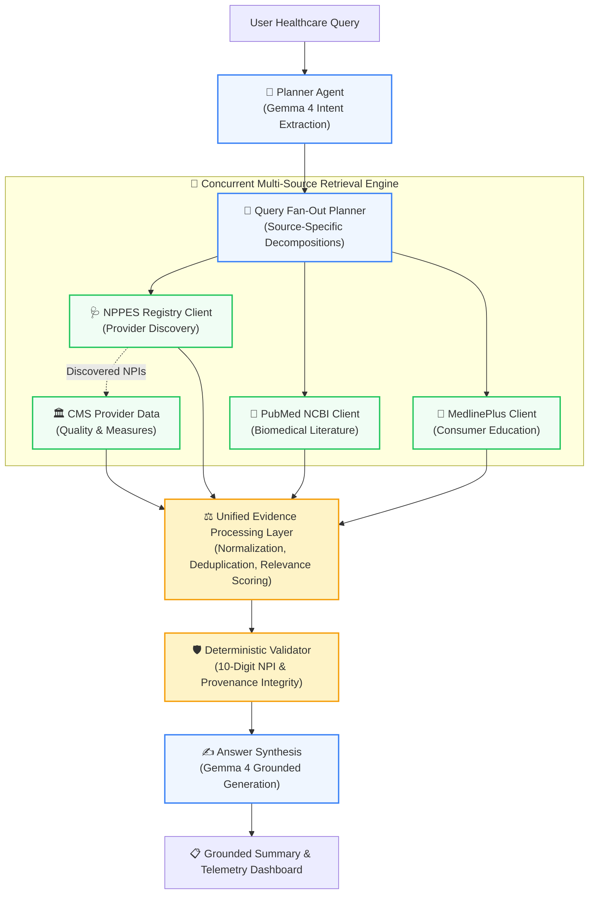

# Milestone M7: Architectural Overview

---

## Architectural Principles

1. **Structured Query Fan-Out**: Single multi-faceted clinical questions (e.g. asking for local pediatric dentists while simultaneously seeking guidance on pediatric dental anxiety) are decomposed into distinct, source-aligned queries with validated parameters.
2. **Bounded Concurrency with Dependency Preservation**:
   - Independent sources (NPPES, PubMed, MedlinePlus) run concurrently via a bounded thread pool (`max_workers=4`).
   - Dependent retrieval (CMS quality lookup for outpatient clinicians) waits until candidate NPIs are extracted from NPPES records.
3. **Transparent Relevance & Explicit Exclusions**:
   - Items lacking topical keywords or addressing unrelated medical conditions (e.g. eating disorders on dental queries) are excluded with recorded justifications.
4. **OTel-Ready Monotonic Telemetry**:
   - Each executed stage and query captures `trace_id`, `span_id`, `parent_span_id`, `query_id`, and `dependency_ids` with monotonic execution duration tracking.
