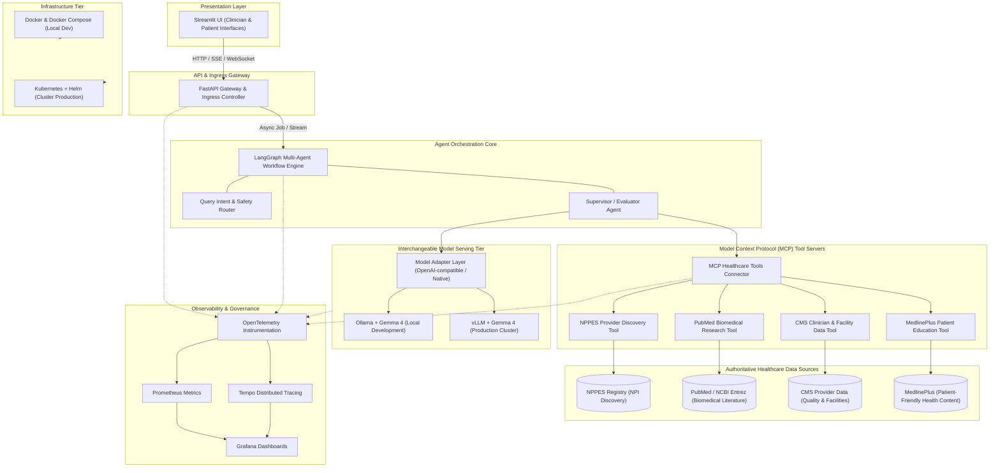

# Target Architecture: Open Healthcare Agentic Platform

> **Status Notice:** This document describes the **TARGET ARCHITECTURE** for the platform.  
> As of Milestone M4A (Live NPPES Provider Discovery), the baseline Python packaging, CLI, configuration scaffolding, local Gemma 4 model adapter (`src/healthcare_agents/models/`), LangGraph multi-agent orchestration workflow (`src/healthcare_agents/workflows/`), and **live CMS NPPES Registry API v2.1 client** (`src/healthcare_agents/retrieval/nppes_client.py`) are active. Live PubMed biomedical literature, CMS quality metrics, MedlinePlus patient education, MCP tools unification, and Kubernetes deployments are planned for upcoming milestones (M4B–M6).

---

## Architectural Overview

The **Open Healthcare Agentic Platform** is designed as a vendor-neutral, evidence-grounded healthcare assistant platform. It connects clinical practitioners, researchers, and patients to trusted public healthcare data sources through autonomous, specialized agents powered by local (Ollama) or cluster-hosted (vLLM) Gemma models.

---

## Core Components

### 1. User Interface Layer
- **Streamlit UI**: Provides role-tailored web interfaces for both healthcare consumers (seeking trusted health definitions, facilities, and care options) and medical professionals (conducting literature reviews and verifying provider credentials).

### 2. API & Gateway Layer
- **FastAPI**: Manages RESTful and streaming HTTP/WebSocket connections, authenticates requests, enforces rate-limiting, and normalizes payloads before handoff to the agent graph.

### 3. Agent Orchestration Core
- **LangGraph**: Implements cyclical multi-agent workflows with persistent state management, human-in-the-loop review points, and dynamic tool selection.
- **Agent Roles**:
  - *Supervisor Agent*: Decomposes multi-part clinical inquiries and schedules subtasks.
  - *Provider Discovery Agent*: Queries NPPES and CMS data to identify certified clinicians and facilities.
  - *Literature Synthesis Agent*: Performs PubMed retrieval and evidence synthesis with citation tracking.
  - *Patient Education Agent*: Translates complex clinical findings into accessible MedlinePlus guidance.
  - *Verification & Safety Agent*: Validates factual grounding against primary tool outputs and flags unsupported hallucinations.

### 4. Interchangeable Model Serving Tier
- **Model Adapter**: Provides a uniform interface for LLM completion and structured function calling.
- **Local Dev**: Serves **Gemma** via **Ollama**.
- **Production / K8s**: Serves high-throughput inference via **vLLM** on GPU nodes.

### 5. Model Context Protocol (MCP) Tool Servers
- Standardized MCP server interfaces exposing four trusted public data sources:
  1. **NPPES (National Plan and Provider Enumeration System)**: National Provider Identifier (NPI) lookups, practice addresses, specialties, and taxonomies.
  2. **PubMed (NCBI Entrez)**: Peer-reviewed biomedical literature, clinical trial abstracts, and citation metadata.
  3. **CMS Provider Data**: Centers for Medicare & Medicaid Services quality metrics, star ratings, and facility information.
  4. **MedlinePlus**: National Library of Medicine consumer health topics, drug monographs, and clinical summaries.

### 6. Infrastructure & Deployment
- **Docker Compose**: Single-command local developer environment provisioning Ollama, MCP servers, API, and UI.
- **Kubernetes + Helm**: Production cloud-native deployment with autoscaling, GPU management for vLLM, and secret management.

### 7. Observability & Telemetry
- **OpenTelemetry (OTel)**: Native distributed tracing across API calls, LangGraph agent hops, LLM generation spans, and MCP tool execution.
- **Prometheus & Grafana**: Service-level metrics, agent latency histograms, and tool failure rates.
- **Tempo**: Deep trace inspection for clinical auditing and agent reasoning transparency.

---

## Non-Clinical Disclaimer
This architecture is developed solely for research, information discovery, and educational purposes. It does not provide medical diagnoses, treatment planning, or direct clinical decision support.
