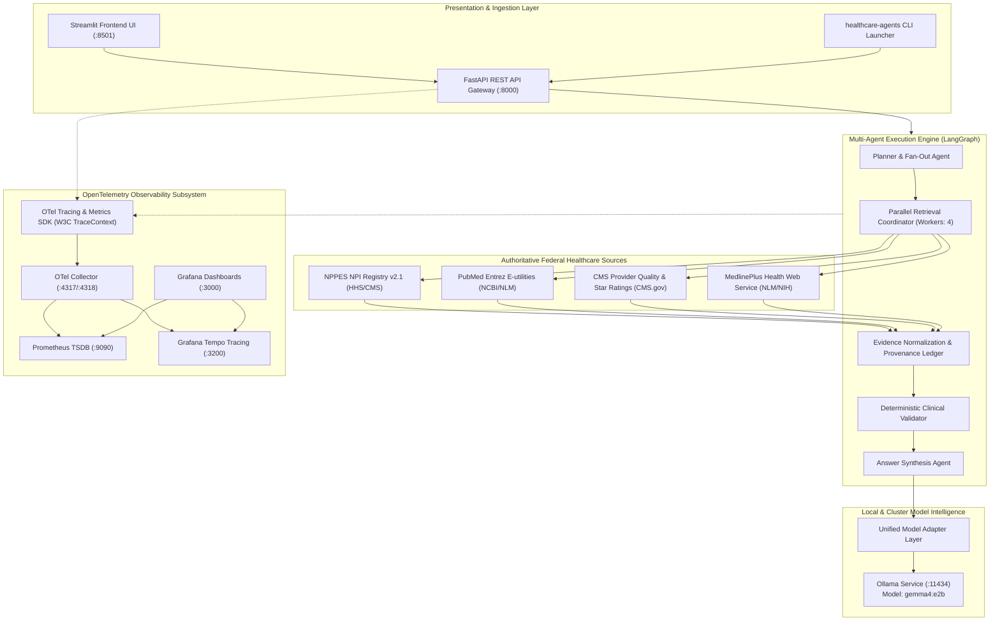

# Platform Architecture Overview

The **Open Healthcare Agentic Platform** is built from the ground up as a vendor-neutral, cloud-native system designed for verifiable healthcare discovery.

---

## Architectural Principles

1. **Deterministic Grounding First:** Language models are strictly bound to authoritative retrieved evidence. Synthesis cannot invent clinicians, affiliations, or studies.
2. **Authoritative Public Registries:** All provider data originates from CMS NPPES; research literature originates from NCBI PubMed; consumer education originates from NLM MedlinePlus; quality metrics originate from CMS Provider Data.
3. **No Lock-in (Vendor Neutral):** Zero proprietary cloud LLM APIs. Local models (Gemma 4 via Ollama) and standard protocols (OpenTelemetry, OCI, W3C TraceContext) allow complete air-gapped operation.
4. **Cloud-Native by Design:** Packaged with PEP 517 wheels, multi-arch Docker containers (`Dockerfile.api`, `Dockerfile.ui`), Kubernetes Kustomize manifests, and Helm OCI distribution charts.
