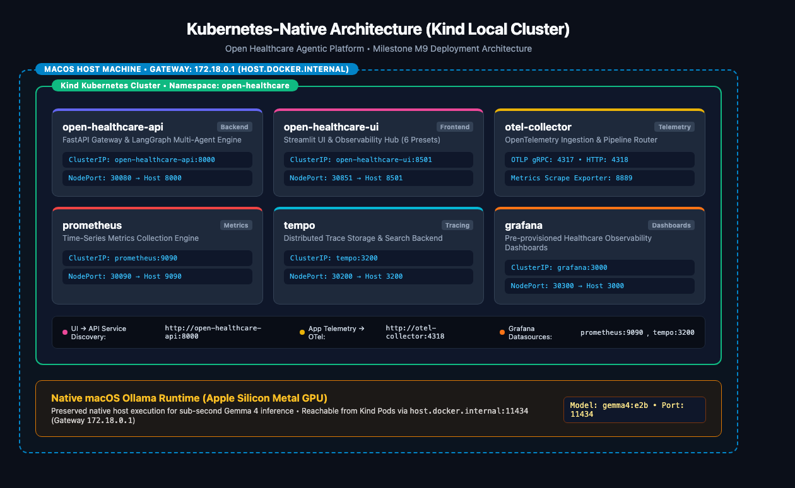
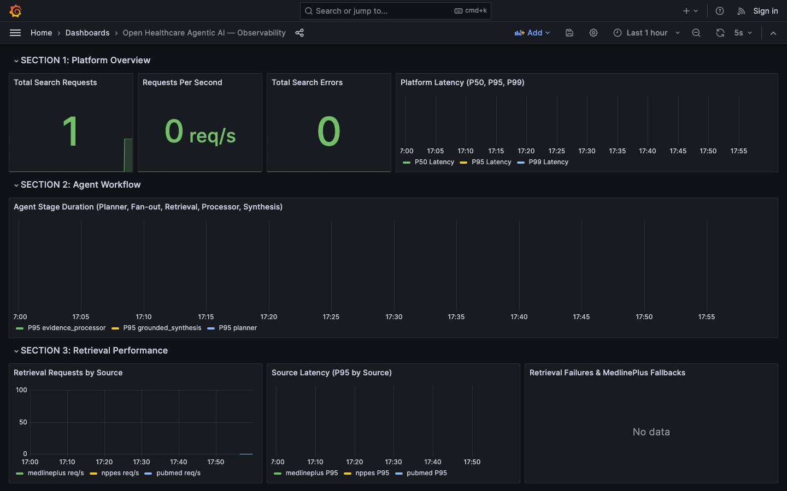
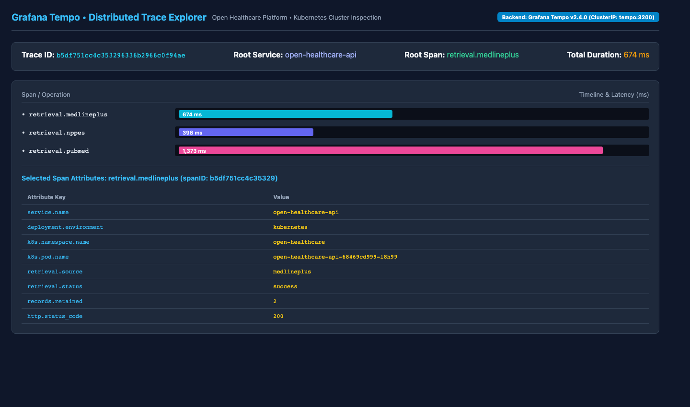
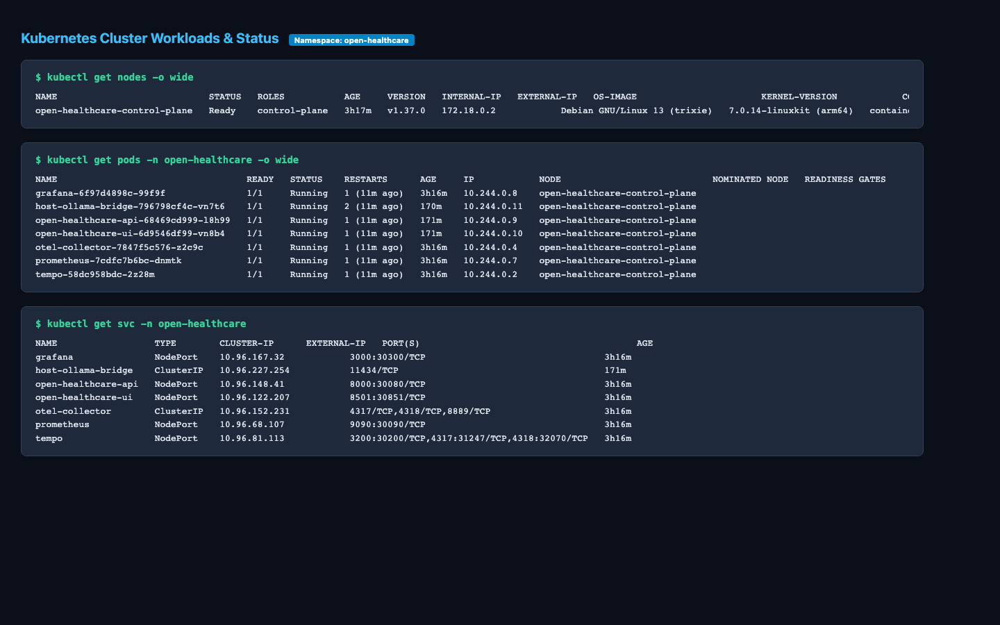

# Kubernetes Deployment Guide (Milestone M9)

This guide documents the architecture, local cluster setup, deployment lifecycle, Ollama host networking, observability integration, smoke testing, and cleanup procedures for the **Open Healthcare Agentic Platform** running on Kubernetes.

---

## 1. Architecture Overview

The Kubernetes deployment provides a declarative, vendor-neutral infrastructure stack managed via **Kustomize** under [`deploy/kubernetes/`](../../deploy/kubernetes/).



### Key Workloads & Components

| Workload | Type | In-Cluster Port | Host NodePort | Purpose |
|---|---|---|---|---|
| `open-healthcare-api` | Deployment + Service | `8000` (ClusterIP) | `30080` &rarr; `8000` | FastAPI Multi-Agent Engine, NPPES/PubMed/MedlinePlus/CMS retrieval, evidence synthesis |
| `open-healthcare-ui` | Deployment + Service | `8501` (ClusterIP) | `30851` &rarr; `8501` | Streamlit interactive discovery frontend with preset queries & developer hub |
| `host-ollama-bridge` | Deployment + Service | `11434` (ClusterIP) | &mdash; | Lightweight in-cluster Nginx reverse proxy connecting cluster Pods to macOS host Ollama |
| `otel-collector` | Deployment + Service | `4317` / `4318` / `8889` | &mdash; | OpenTelemetry Collector routing traces to Tempo and metrics to Prometheus |
| `prometheus` | Deployment + Service | `9090` (ClusterIP) | `30090` &rarr; `9090` | Time-series metrics engine scraping Collector metrics at 2s intervals |
| `tempo` | Deployment + Service | `3200` (ClusterIP) | `30200` &rarr; `3200` | Grafana Tempo distributed trace storage and search |
| `grafana` | Deployment + Service | `3000` (ClusterIP) | `30300` &rarr; `3000` | Pre-provisioned dashboards and trace exploration |

---

## 2. Local Kubernetes Distribution: Kind (Kubernetes in Docker)

### Selection Rationale
1. **Developer Environment Alignment:** Kind operates directly against the local Docker daemon without requiring third-party hypervisors (VirtualBox, HyperKit).
2. **Deterministic Multi-Port Ingress:** Kind allows explicit `extraPortMappings` in its cluster definition (`kind-config.yaml`), exposing container NodePorts directly on `localhost:8000`, `8501`, `3000`, `9090`, and `3200`.
3. **Hermetic CI/CD Readiness:** Kind runs reliably in GitHub Actions runners for automated manifest validation and smoke tests without dedicated cloud infrastructure.

---

## 3. Host Ollama Connectivity (Apple Silicon Metal GPU)

### Problem & Challenge
On macOS, Ollama runs natively on the host to leverage Apple Silicon Unified Memory and the Metal GPU acceleration framework. When containers run inside a Kind cluster (which itself runs inside Docker Desktop's Linux VM), `localhost:11434` points to the container itself, while raw `host.docker.internal` DNS lookups may fail or be rejected with HTTP 403 Forbidden because host-native Ollama binds to `localhost` and validates the incoming `Host` HTTP header.

### Solution: `host-ollama-bridge`
Milestone M9 introduces an in-cluster reverse-proxy service `host-ollama-bridge`:
- Routes to `host.docker.internal:11434` via Docker Desktop host gateway `172.18.0.1`.
- Rewrites the `Host` header to `localhost:11434` with `proxy_read_timeout 300s`.
- Allows `open-healthcare-api` to connect seamlessly using standard Kubernetes DNS: `http://host-ollama-bridge:11434`.

---

## 4. Observability Integration (Option A: In-Cluster Stack)

Milestone M9 deploys a complete CNCF observability stack directly in namespace `open-healthcare`:
- **Traces:** FastAPI and LangGraph spans export via OTLP/HTTP to `http://otel-collector:4318`, which routes them to `tempo:4317`.
- **Metrics:** `HealthcareMetrics` export to `otel-collector`, which exposes a Prometheus scrape endpoint on port `8889`. Prometheus scrapes this every 2 seconds.
- **Dashboards:** Grafana pre-provisions datasources (Prometheus & Tempo) and the platform dashboard from `deploy/kubernetes/base/observability/grafana.yaml`.




---

## 5. Deployment Commands & Workflow

### 1. One-Command Kubernetes Deployment
```bash
uv run python scripts/k8s_deploy.py
```
This script automates:
1. Verifying prerequisites (`docker`, `kind`, `kubectl`).
2. Checking host Ollama and `gemma4:e2b` availability.
3. Creating the `open-healthcare` Kind cluster with host port bindings.
4. Loading container images (`open-healthcare-api`, `open-healthcare-ui`).
5. Applying Kustomize overlays (`deploy/kubernetes/overlays/local`).
6. Waiting for all deployments to reach `Ready` status.

### 2. Checking Cluster & Workloads Status
```bash
kubectl get nodes -o wide
kubectl get pods -n open-healthcare -o wide
kubectl get svc -n open-healthcare
```


### 3. Automated Smoke Tests
```bash
uv run python scripts/k8s_smoke_test.py
```
Validates:
- All Pods in `open-healthcare` namespace are in `Running` phase.
- FastAPI readiness probe (`/health` &rarr; 200).
- Streamlit readiness probe (`/_stcore/health` &rarr; 200).
- Tempo server status (`/status` &rarr; 200).
- Grafana health check (`/api/health` &rarr; 200).
- In-cluster Ollama connectivity via `host-ollama-bridge`.
- Live end-to-end multi-agent search query execution.
- Prometheus time-series metric ingestion from OpenTelemetry collector.

### 4. Viewing Logs
```bash
# Backend API logs
kubectl logs -n open-healthcare deployment/open-healthcare-api -f

# UI logs
kubectl logs -n open-healthcare deployment/open-healthcare-ui -f

# OTel Collector logs
kubectl logs -n open-healthcare deployment/otel-collector -f
```

### 5. Scoped Cleanup
```bash
# Option A: Delete namespace only, preserving the Kind cluster
uv run python scripts/k8s_cleanup.py --namespace-only

# Option B: Delete the dedicated open-healthcare Kind cluster safely
uv run python scripts/k8s_cleanup.py
```

---

## 6. Docker Compose Preservation

The primary Docker Compose local developer launcher remains 100% supported:
```bash
uv run python scripts/run_demo.py
```
Docker Compose and Kubernetes run in distinct configurations without interfering with one another.

---

## 7. Known Limitations & Follow-ups

1. **Local Host Bridge:** `host-ollama-bridge` is designed for local Kind deployments on macOS. Production multi-node cloud Kubernetes clusters will connect to managed inference endpoints (e.g. vLLM or Ollama cluster services).
2. **Cluster Autoscaling:** Pod autoscaling (HPA / KEDA) is scheduled for a future milestone (Issue #6).
3. **Production Ingress:** Ingress controllers (Traefik/Ingress-NGINX) with TLS termination are intended for cloud deployment stages.
