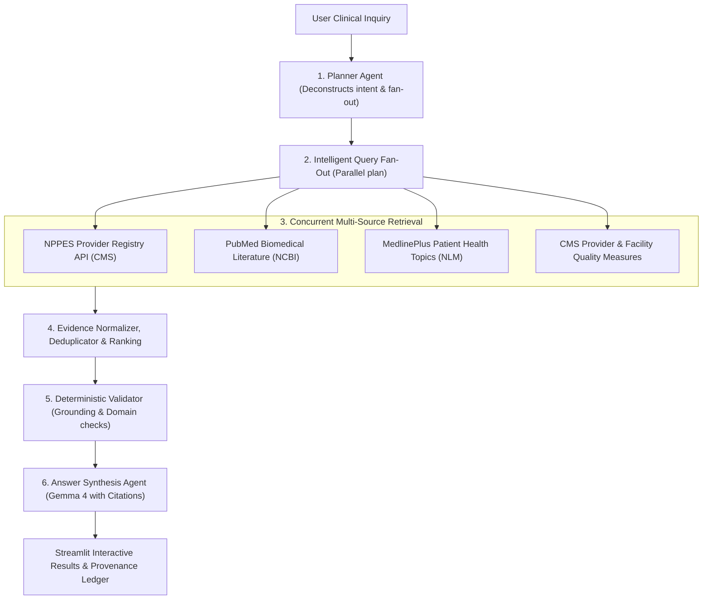

# First Healthcare Agent Walkthrough

> **Objective:** Execute a complete, evidence-grounded healthcare discovery query and trace multi-agent execution from UI to telemetry.  
> **Disclaimer:** This software is for educational, research, and informational discovery only. It is **NOT** a medical device or diagnostic tool and does not provide clinical advice.  

---

## 1. Quick Demonstration Workflow

### Step 1: Start Platform Services
In your terminal, run:
```bash
healthcare-agents check
healthcare-agents start
```
Your browser will open automatically to `http://localhost:8501`.

---

### Step 2: Select a Preset Query
In the Streamlit interface, you can select one of the pre-configured clinical discovery scenarios:
- **Scenario 1 (Pediatric Dentistry):** `"Find pediatric dentists in Houston with hospital affiliations"`
- **Scenario 2 (Cardiology Research):** `"Cardiology clinical guidelines for heart failure with preserved ejection fraction"`
- **Scenario 3 (Diabetes Care):** `"Type 2 diabetes patient education and local endocrinologists in Chicago"`

Click **"Run Multi-Agent Healthcare Discovery"**.

---

### Step 3: Understanding Multi-Agent Orchestration

The search executes a 6-stage LangGraph pipeline:



---

### Step 4: Inspecting Results

The Streamlit UI displays four comprehensive result tabs:

1. **Grounded Answer:** Narrative summary generated by Gemma 4 with explicit citation badges.
2. **Healthcare Providers:** Real verified clinicians retrieved from NPPES with 10-digit NPIs, primary specialties, practice addresses, and matched CMS hospital ratings.
3. **Research Evidence:** Peer-reviewed clinical publications from NCBI PubMed with title, journal, publication date, abstract, and direct PMID/DOI links.
4. **Patient Education:** Curated consumer health topics from NLM MedlinePlus with structured paragraphs, health FAQs, and official URLs.
5. **Provenance Ledger:** Verifiable cryptographic audit trail displaying source URLs, timestamps, query digests, and domain verification (`nih.gov`, `cms.gov`, `hhs.gov`).

---

### Step 5: Viewing Execution Telemetry & Traces

Click the **"🧠 Agent Execution & Observability"** tab in Streamlit:
- **Stage Timings:** View monotonic duration breakdowns across Planning, Fan-Out, Concurrent Retrieval, Evidence Processing, and Synthesis.
- **Inspect Dispatched Queries:** Inspect the exact queries generated by the Planner and sent to each federal API.
- **Trace Deep Link:** Copy the W3C Hex Trace ID (e.g., `e86019653ebc...`) or click the deep link to explore the full span waterfall in Grafana Tempo (`http://localhost:3000`).

---

### Step 6: Stopping the Demo
When finished, stop background processes cleanly:
```bash
healthcare-agents stop
```
