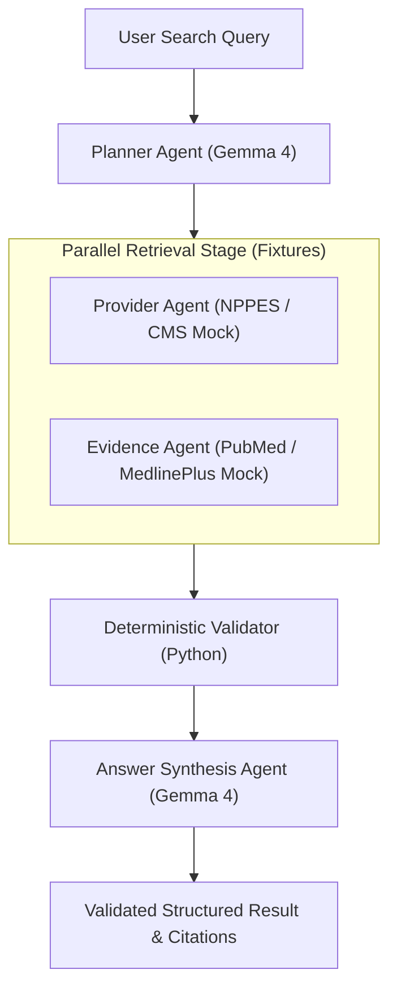

# Milestone M03: LangGraph Multi-Agent Orchestration

> **Status:** Complete  
> **Target Tag:** `v0.3.0-m03`  
> **Core Model:** Gemma 4 (`gemma4:e2b` via Ollama)  
> **Orchestrator:** LangGraph (`langgraph>=0.2.0`)

---

## 1. Summary

Milestone M03 implements the core agent orchestration engine for the Open Healthcare Agentic Platform. Using LangGraph, the workflow coordinates intent planning, provider discovery, research evidence retrieval, deterministic rule-based verification, and grounded answer synthesis.

---

## 2. Implemented Architecture



### Components
1. **Planner Agent (`planner.py`)**: Uses local Gemma 4 to parse intent, extract specialty and location, and generate a validated `SearchPlan`.
2. **Provider Agent (`provider.py`)**: Retrieves clinician and practice fixtures (`FixtureProviderRetriever`).
3. **Evidence Agent (`evidence.py`)**: Retrieves clinical literature and patient education fixtures (`FixtureEvidenceRetriever`).
4. **Deterministic Validator (`validator.py`)**: Verifies required NPI fields, enforces deduplication, validates source provenance, and filters unsupported claims without relying on LLM self-evaluation.
5. **Answer Agent (`answer.py`)**: Synthesizes grounded summaries strictly adhering to validated records with explicit citations and demonstration disclaimers.

---

## 3. CLI Command

```bash
# Execute healthcare discovery workflow
healthcare-agents search --query "Find pediatric dentists in Houston"

# Detailed stage progression
healthcare-agents search --query "Find pediatric dentists in Houston" --verbose
```

---

## 4. Verification & Quality Gates

- **Unit & Integration Tests**: 61 passed with live inference enabled (57 offline passed in 0.50s).
- **Test Coverage**: 96.14% (exceeds 90.0% threshold).
- **Ruff Lint & Format**: Passed with 0 issues.
- **Mypy Strict**: Passed with 0 issues across 30 files.
- **Package Wheel Build**: Verified clean installation in isolated Python 3.12 environment.
