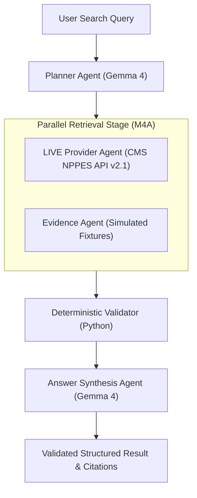

# Milestone M04A: Live NPPES Provider Discovery

> **Status:** Complete & Verified  
> **Target Tag:** `v0.4.0-m04a`  
> **Registry API:** CMS NPPES NPI Registry API version 2.1  
> **Core Model:** Gemma 4 (`gemma4:e2b` via Ollama)  
> **Orchestrator:** LangGraph (`langgraph>=0.2.0`)

---

## 1. Summary

Milestone M04A replaces synthetic provider candidate fixtures in the LangGraph Provider Agent with **real, live provider discovery** from the public CMS National Plan and Provider Enumeration System (NPPES) Registry API version 2.1.

---

## 2. Architecture & Flow

---

## 3. Key Enhancements

1. **NPPES Provider Retriever (`retrieval/nppes_client.py`)**:
   - Live HTTP client for `https://npiregistry.cms.hhs.gov/api/?version=2.1`.
   - Supports specialty, taxonomy description, city, state, and direct 10-digit NPI lookup.
   - Bounded retries with exponential backoff and rate-limit awareness.
   - Normalizes practice location (`address_purpose == "LOCATION"`) vs mailing address (`MAILING`), phone numbers, and taxonomy codes.
2. **Configurable Retrieval Mode**:
   - `RETRIEVAL_MODE=live` (default) for live NPPES provider discovery.
   - `RETRIEVAL_MODE=fixture` for deterministic offline testing.
3. **Deterministic Python Validator**:
   - Enforces 10-digit numeric format validation on all retrieved NPIs.
   - Eliminates duplicate NPI records and preserves source provenance.
4. **CLI Enhanced Discovery**:
   - `healthcare-agents search --query "..." --verbose` displays real clinician NPIs, practice addresses, telephone numbers, and ISO retrieval timestamps.
