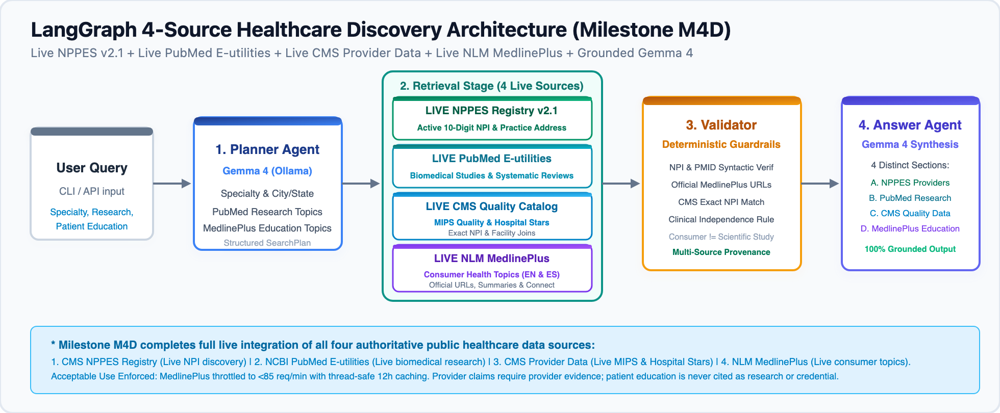

# Milestone M4D: Live MedlinePlus Patient Education Integration

> **Version**: `0.4.3`  
> **Milestone Tag**: `v0.4.3-m04d`  
> **Status**: Verified & Complete  

---

## Executive Summary

Milestone M4D completes the live integration of all **four** foundational public healthcare data sources into the open healthcare agentic platform. It connects the workflow to the official **U.S. National Library of Medicine (NLM) MedlinePlus Web Service**, replacing simulated consumer health fixtures with live, authoritative patient education resources.

```
       [User Query]
            │
            ▼
   [1. Planner Agent] (Gemma 4 via Ollama)
            │
            ▼
   [2. Multi-Source Live Retrieval Stage]
   ┌────────────────────────────────────────────────────────┐
   │ • Live NPPES Registry v2.1   (Active Clinicians & NPI) │
   │ • Live PubMed E-utilities    (Biomedical Literature)   │
   │ • Live CMS Provider Data     (MIPS & Hospital Stars)   │
   │ • Live NLM MedlinePlus       (Consumer Health Topics)  │
   └────────────────────────────────────────────────────────┘
            │
            ▼
   [3. Deterministic Validator]
   (Guarantees NPI validity, official MedlinePlus URLs, CMS NPI matching,
    and enforces clinical independence guardrails)
            │
            ▼
   [4. Answer Synthesis Agent] (Gemma 4)
   (Four distinct, fully-grounded sections with complete citations)
```

---

## Official APIs Integrated

### 1. MedlinePlus Keyword Web Service
- **Endpoint**: `https://wsearch.nlm.nih.gov/ws/query`
- **Format**: XML parsing
- **Databases**:
  - `db=healthTopics`: English health topics
  - `db=healthTopicsSpanish`: Spanish health topics
- **Features**:
  - Rate limiting ($\le 85$ req/min via client-side throttling)
  - Thread-safe TTL cache (default 12 hours)
  - HTML tag stripping for search highlight spans
  - Preserves official URLs, titles, and plain-language summaries

### 2. MedlinePlus Connect (Code-Based Adapter)
- **Endpoint**: `https://connect.medlineplus.gov/service`
- **Format**: JSON
- **Standard Codes**: ICD-10-CM (`2.16.840.1.113883.6.90`), SNOMED CT, RxCUI, LOINC

---

## Architectural Diagram



---

## Verification & Quality Gates Summary

- **Total Offline Tests**: 96 passed (15 skipped live tests)
- **Offline Code Coverage**: 91.64% ($\ge 90.0\%$ gate passed)
- **Linting & Formatting**: Ruff checks passed cleanly
- **Type Checking**: mypy strict passed across 42 source files
- **Package Build**: Wheel and source distribution built and verified in clean venv
- **Live Integration**: Live NPPES, PubMed, CMS, and MedlinePlus tested against public endpoints
- **CLI Search Demo**: Fully grounded multi-source response with real citations and zero simulated patient education fixtures
