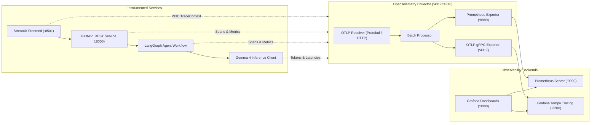

# Observability Guide: OpenTelemetry, Prometheus, Tempo & Grafana

The platform includes a complete, production-grade cloud-native observability stack adhering to CNCF standards.

---

## 1. Architecture & Telemetry Pipeline



---

## 2. Ports & Endpoints

| Service | Host Port | Protocol | Purpose |
| :--- | :--- | :--- | :--- |
| **Streamlit UI** | `8501` | HTTP | Interactive Web Frontend |
| **FastAPI Backend** | `8000` | HTTP | REST Service API & `/docs` Swagger |
| **Grafana UI** | `3000` | HTTP | Pre-provisioned dashboards (Anonymous viewer enabled) |
| **Prometheus** | `9090` | HTTP | Metrics scraping, TSDB storage & Prometheus Query UI |
| **Grafana Tempo** | `3200` | HTTP | Distributed trace ingestion & Jaeger/Tempo query API |
| **OTel Collector HTTP**| `4318` | HTTP/Protobuf | Ingestion endpoint for application traces and metrics |
| **OTel Collector gRPC**| `4317` | gRPC | Ingestion endpoint for OTLP gRPC telemetry |

---

## 3. Pre-Configured Grafana Dashboard

The dashboard **"Open Healthcare Agentic AI — Observability"** (`uid: healthcare-observability`) contains 6 dedicated sections:

1. **Section 1: Platform Overview & Latency Telemetry**: Total request throughput, error rates, P50/P95/P99 end-to-end latency.
2. **Section 2: LangGraph Agent Workflow Execution**: Per-stage execution duration (Planner, Fan-Out, Parallel Retrieval, Normalization, Synthesis).
3. **Section 3: Parallel Multi-Source Retrieval Metrics**: Throughput, latencies, failure rates, and zero-hit consumer fallback events across NPPES, PubMed, CMS, and MedlinePlus.
4. **Section 4: Evidence Processing & Filtering Quality**: Counts of retrieved, retained, deduplicated, and excluded items.
5. **Section 5: Local Gemma 4 / Ollama Inference Metrics**: Real prompt token count, completion token count, and inference durations.
6. **Section 6: Tempo Distributed Trace Explorer**: Deep-link trace exploration with span graphs and waterfalls.

---

## 4. How to Inspect Live Telemetry

1. **Start Observability Containers:**
   ```bash
   docker compose up -d
   ```
2. **Generate Telemetry:**
   Run a search query in Streamlit (`http://localhost:8501`) or via CLI:
   ```bash
   healthcare-agents search --query "Find cardiologists in Boston"
   ```
3. **Open Grafana:**
   Navigate to `http://localhost:3000/d/healthcare-observability/`.
4. **Follow a Trace in Tempo:**
   Copy the `Trace ID` displayed at the bottom of the Streamlit search results and search for it under Grafana Explore $\rightarrow$ Tempo.
